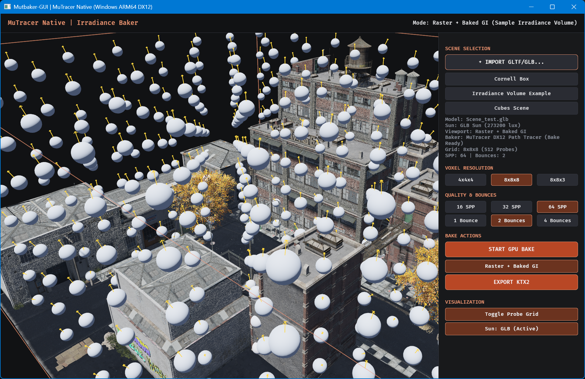
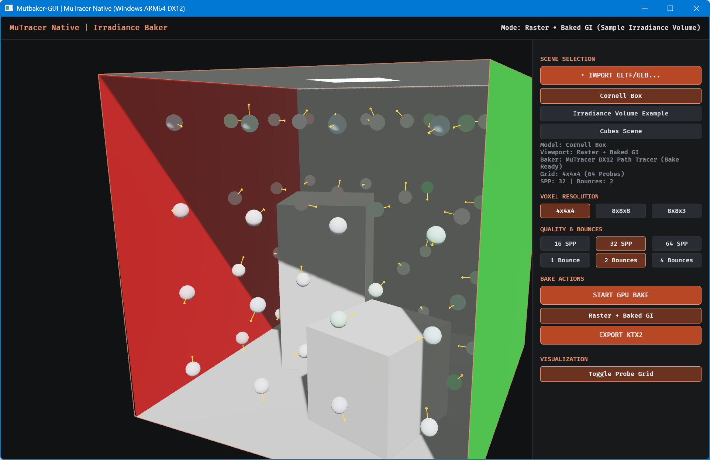

# Mutbaker-GUI
# VIBE CODED. USE WITH CAUTION!
A bevy/rust-based reimplementation & modification of Mutracer by pissang(https://github.com/pissang/mutracer) as both a renderer and lightgrid baker for Bevy and Irradiance Volume. mutracer-native is the core.  

以mutracer为原型的本地化（Rust+Bevy）移植和修改，输出Bevy Irradiance Volume所需的全局光照数据。核心模块为mutracer-native  

Planned:Static lightmap baking  

计划：Lightmap光照贴图输出模式  

Alternative:Headless baking mode using mutracer-native  

可选：无头烘焙模式，直接使用核心mutracer-native

mutracer-native bake [options]  

mutracer-native probe-gpu  

mutracer-native verify-ktx2 <path.ktx2>  

#### 常用参数列表
| 参数 | 说明 | 示例 | 默认值 |
| :--- | :--- | :--- | :--- |
| `--scene` | glTF / GLB 输入场景路径（必填） | `--scene "model.glb"` | 无 |
| `--out` | 输出 KTX2 3D 贴图路径 | `--out "output.vxgi.ktx2"` | `irradiance.vxgi.ktx2` |
| `--resolution` | 体素分辨率 $(X, Y, Z)$ | `--resolution 8,8,8` | `8,8,8` |
| `--spp` | 每个立方体方向的采样光线数 | `--spp 64` | `64` |
| `--bounces` | 最大漫反射弹射反弹深度 | `--bounces 2` | `2` |
| `--bounds` | 自定义包围盒 $(minX,minY,minZ,maxX,maxY,maxZ)$ | `--bounds -5,0,-5,5,5,5` | 自动根据场景 AABB + 5% 扩展 |
| `--hdri` | 指定等距柱状投影（Equirectangular）`.hdr` 环境贴图路径| `--hdri path.hdr` | 无（不启用 HDRI，使用默认渐变天空） |
| `--hdri-intensity` | HDRI 亮度/强度倍率（线性倍率，如 `0.5`、`1.5`）| `--hdri-intensity val` | `1.0` |
| `--hdri-rotation` | 绕世界 Y 轴旋转角度（单位：度，如 `45`、`90`、`180`）| `--hdri-rotation deg` | `0.0` |

#### 产物输出
每次烘焙完成会自动输出两个文件：
1. **`.ktx2` 贴图文件**：严格遵循 Bevy `IrradianceVolume` 规范的 3D 纹理（格式为 `VK_FORMAT_E5B9G9R9_UFLOAT_PACK32`，按 Valve Ambient Cube 6 轴布局）。
2. **`.meta.json` 元数据文件**：包含体素分辨率、包围盒中心、缩放尺度，以及**直接可粘贴至 Bevy 场景中的 Rust 初始化代码片段**。

